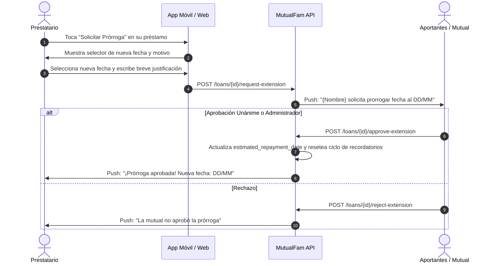

# Plan Futuro: Extensión y Renegociación de Fechas de Devolución por Mutuo Acuerdo

## 1. Contexto y Justificación
En el contexto de **MutualFam**, los préstamos ocurren entre familiares y personas de un círculo de confianza. A diferencia de un banco tradicional, la dinámica comunitaria contempla imprevistos reales (retrasos en cobro de salario/quincena, emergencias médicas imprevistas, dificultades bancarias temporales).

Cuando un prestatario se acerca a la fecha límite o esta se vence, una práctica altamente humana y efectiva es permitir **renegociar o solicitar una extensión de la fecha estimada** directamente en la aplicación, evitando fricciones informales o incertidumbre entre los miembros de la mutual.

---

## 2. Flujo Propuesto de Renegociación

---

## 3. Reglas de Negocio a Implementar

1. **Límite de solicitudes**:
   * Máximo 1 solicitud de prórroga activa por préstamo.
   * Máximo de prórrogas permitidas por préstamo (ej. máximo 2 extensiones por solicitud para preservar la disciplina financiera).
2. **Quién aprueba**:
   * **Esquema A (Recomendado para mutuales familiares)**: Aprobación por los aportantes que financiaron el préstamo (o el administrador/junta de la mutual si es un fondo común).
   * **Esquema B (Simplificado)**: Aprobación por mayoría simple de los aportantes.
3. **Reajuste automático del sistema de recordatorios**:
   * Al aprobarse una nueva fecha:
     * Se actualiza `estimated_repayment_date = nueva_fecha`.
     * Se resetea `last_repayment_reminder_date = None`.
     * El motor de recordatorios (`repayment_reminders.py`) reanuda el ciclo preventivo (D-3, D-1, D-0, D+2, diario) tomando como base la nueva fecha acordada.
4. **Historial y Transparencia**:
   * Se registra en la bitácora del préstamo: fecha original solicitada, fechas prorrogadas y motivo. Visible para todos los miembros de la mutual.

---

## 4. Estado de Implementación
* **Fase Actual**: Registrado como especificación y hoja de ruta futura.
* **Próxima Fase**: Desarrollo de endpoints en backend y modal de solicitud en interfaz gráfica.
