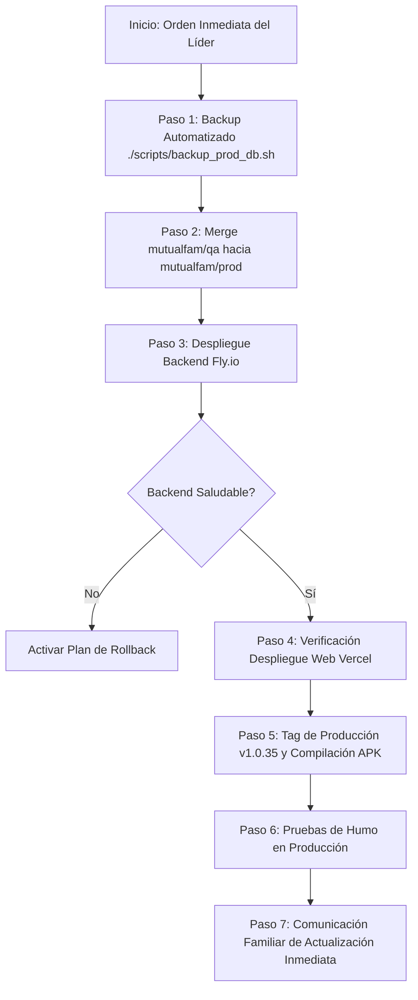

# Plan de Control de Cambios: Pase a Producción (v1.0.35)

> **Documento:** Plan de Gestión y Control de Cambios (RFC)  
> **Fecha de Actualización:** 31 de Octubre de 2026 (20:10 UTC-4)  
> **Versión Origen (Producción Actual):** `v1.0.25`  
> **Versión Destino (Candidata a Release):** `v1.0.35` (`commit 06b67cd0`)  
> **Entornos Involucrados:** `mutualfam-qa` ➔ `mutualfam-prod`  
> **Estado:** 🟡 Listo para Ejecución (Aprobaciones y Respaldos Automatizados)  

---

## 1. Contexto y Justificación del Cambio

Desde el lanzamiento de la versión Beta (`v1.0.25`), la plataforma MutualFam ha estado operando en producción con usuarios reales (núcleo familiar y evaluadores iniciales), procesando solicitudes de préstamos, aportes, registros bancarios y acuerdos mutuos.

Durante este período de funcionamiento activo, se acumularon múltiples mejoras estructurales, optimizaciones y correcciones en la rama `mutualfam/qa` que han sido homologadas y certificadas con el **100% de éxito en 38 pruebas automatizadas E2E**, incluyendo el reciente soporte de red sin conexión con persistencia de perfil local y estados visuales coherentes (`v1.0.35-qa`).

Dado que **es el primer pase a producción con la aplicación en caliente y usuarios activos**, se requiere un procedimiento formal, metódico y seguro para garantizar:
1. **Cero pérdida de datos** transaccionales ni de configuración en la base de datos SQLite de producción.
2. **Actualización inmediata y directa** en los dispositivos de los familiares (Android APK y Web/PWA Safari).
3. **Mínima o nula ventana de indisponibilidad** en el servicio Backend (Fly.io) y Web/PWA (Vercel).
4. **Capacidad de reversión inmediata (Rollback)** ante cualquier contingencia.

---

## 2. Alcance del Release (Diferencial v1.0.25 ➔ v1.0.35)

El pase a producción consolida 10 versiones menores/parches probadas exhaustivamente en QA:

| Componente | Mejoras y Cambios Clave Incorporados |
|---|---|
| **Base de Datos & Backend** | • Nueva columna en `loan_requests`: `last_repayment_reminder_date` (con auto-migración segura `ensure_reminder_column_exists`).<br>• Tarea en segundo plano de recordatorios push automáticos de vencimiento (D-3, D-1, D-0, D+2).<br>• Blindaje estricto de invitaciones únicas de un solo uso (`HTTP 400`).<br>• Límite de miembros por mutual (`15` en producción vs `5` en QA).<br>• Regla 1 de gobernanza: límite de 1 mutual extra por miembro fundador. |
| **Moneda & Finanzas** | • Sistema bimoneda completo (USD y Bs. VES) con tasa dinámica oficial BCV.<br>• Memoria de preferencia de visualización monetaria en cliente.<br>• Homologación de métodos de pago venezolanos (Pago Móvil y Transferencia) en solicitud, aporte y devolución. |
| **Clientes Móviles & Web** | • **Manejo offline robusto:** detección de corte de red, estados vacíos informativos, banners de desconexión y retención de mutual activa en memoria local sin expulsar sesión.<br>• **Persistencia de Perfil Offline (v1.0.35):** almacenamiento local de datos de usuario (`cached_user_profile`) y pastilla de estado dinámica (🟢 *Conectado* / 🟡 *Sin conexión*) sin parpadeo de *"Cargando datos..."*.<br>• **Experiencia iOS / PWA:** layout nativo con pestañas inferiores, selector de mutual optimizado, y guía de instalación en Safari.<br>• **Descargas Android:** flujo dual simplificado (descarga directa de APK y distribución vía Firebase App Distribution).<br>• **Tematización visual:** paleta azul corporativa distintiva para Producción (evitando confusión con verde esmeralda de QA).<br>• **Reconocimientos Beta:** inclusión de evaluadores familiares (Nora Salazar, Nilso Salazar, Martín Vieira). |

---

## 3. Matriz de Riesgos y Acciones de Mitigación

| # | Riesgo Identificado | Nivel de Impacto | Probabilidad | Estrategia de Mitigación |
|---|---|:---:|:---:|---|
| **R1** | **Inconsistencia o daño en SQLite de Prod (`mutualfam.db`)** | 🔴 Crítico | Baja | • **Backup automatizado previo:** Ejecución obligatoria de `./scripts/backup_prod_db.sh` con verificación de integridad SQLite (`PRAGMA integrity_check`) antes de desplegar.<br>• La migración de columna se ejecuta con `ALTER TABLE ADD COLUMN` tolerante a fallas (`try/except`). |
| **R2** | **Discrepancia de versiones entre usuarios familiares** | 🟠 Alto | Media | • **Estrategia de Actualización Inmediata:** Notificación directa al grupo familiar para instalación inmediata de la nueva versión sin dilación. |
| **R3** | **Interrupción transaccional durante el reinicio de Fly.io** | 🟡 Medio | Baja | • Debido a la baja concurrencia actual, el pase se ejecuta **a demanda inmediata** tan pronto lo ordene el líder de proyecto.<br>• El reinicio del backend en Fly.io toma menos de 10 segundos. |
| **R4** | **Caché en navegadores o PWA de iOS mostrando versión vieja** | 🟡 Medio | Media | • Cabeceras HTTP estrictas en `vercel.json` (`Cache-Control: no-cache, must-revalidate`).<br>• Indicador visible de versión `1.0.35` en Perfil/Ajustes. |
| **R5** | **Falla en el motor de recordatorios push en caliente** | 🟡 Medio | Baja | • **Validación previa en QA:** Ejecución y confirmación del ciclo de recordatorios con un préstamo de prueba en QA antes de tocar producción. |

---

## 4. Criterios de Aceptación (Go / No-Go Decision Gate)

Para dar la orden de inicio (**GO**) del pase a producción, se deben cumplir todas las condiciones:

- [ ] **C0. Validación de Recordatorios en QA:** Préstamo de prueba en QA con recordatorios automáticos disparados y validados (`POST /loans/check-reminders`).
- [ ] **C1. Pruebas QA Finales Aprobadas:** Usuario y equipo de QA completan y aprueban las pruebas de la versión `v1.0.35-qa`.
- [ ] **C2. Certificación E2E Vigente:** 38 de 38 pruebas automatizadas superadas al 100%.
- [ ] **C3. Backup Automatizado de Producción:** Ejecución exitosa de `./scripts/backup_prod_db.sh --env=prod` con verificación `integrity_check: ok`.
- [ ] **C4. Secretos de Producción Verificados:** Vigencia de `FLY_API_TOKEN_PROD` y credenciales de Firebase en GitHub Actions.
- [ ] **C5. Orden de Ejecución:** Aprobación directa del líder de proyecto para inicio inmediato.

> [!CAUTION]
> Si cualquiera de los criterios C0 a C4 no se cumple, el pase se suspende (**NO-GO**) y se reprograma.

---

## 5. Procedimiento de Despliegue Paso a Paso



### Paso 1: Respaldo Automatizado de Base de Datos (Producción)
Se ejecuta el nuevo script automatizado de respaldo que descarga la base de datos por SFTP seguro y certifica su integridad:

```bash
# Ejecutar respaldo automatizado de producción
./scripts/backup_prod_db.sh --env=prod

# Salida esperada:
# ✔ Sesión activa como: jorgerojasve@gmail.com
# ✔ Archivo descargado exitosamente (~172 KB)
# ✔ Integridad certificada: ok
# ✔ Copia más reciente actualizada en: ./backups/mutualfam-backend_latest.db
```

---

### Paso 2: Promoción de Código (Merge de QA a Prod)
Se integra el árbol de cambios limpio y certificado de `mutualfam/qa` a `mutualfam/prod`:

```bash
# 1. Cambiar a la rama de producción
git checkout mutualfam/prod

# 2. Asegurar que está sincronizada con el remoto
git pull origin mutualfam/prod

# 3. Integrar los cambios certificados de QA
git merge mutualfam/qa --no-ff -m "chore(release): promocion de QA v1.0.35 a produccion"

# 4. Enviar a los remotos principales
git push github mutualfam/prod
git push origin mutualfam/prod
```

---

### Paso 3: Despliegue del Backend en Producción (Fly.io)
El push a `mutualfam/prod` dispara automáticamente el workflow `.github/workflows/deploy-backend.yml` configurado con `fly.toml` y la app `mutualfam-backend`.

*Monitoreo y verificación:*
```bash
# Ver estado de la máquina y logs en vivo
flyctl logs -a mutualfam-backend
flyctl status -a mutualfam-backend

# Verificar endpoint público de configuración y salud
curl -s https://mutualfam-backend.fly.dev/api/v1/config/ | jq .
```
Debe responder con `limits.max_members_per_mutual: 15`, tasa BCV activa y auto-migración completada.

---

### Paso 4: Verificación de la Web App / PWA (Vercel)
Vercel desplegará automáticamente la rama `mutualfam/prod` en el dominio `https://mutualfam.vercel.app`.

*Verificaciones requeridas:*
1. Abrir `https://mutualfam.vercel.app` en modo incógnito.
2. Comprobar que el tema visual corresponda a Producción (azul) y no a QA (esmeralda).
3. Verificar en `Ajustes / Perfil` que el número de versión indique `1.0.35`.
4. Comprobar que no haya errores de consola en DevTools.

---

### Paso 5: Generación y Publicación de la APK de Producción
Para disparar el workflow de compilación de Android (`build-apk.yml`) en modo **Producción**, se crea y publica el tag sin sufijo `-qa`:

```bash
# 1. Crear tag oficial de producción
git tag -a v1.0.35 -m "Release Produccion v1.0.35: soporte offline, bimoneda, limites y mejoras UI"

# 2. Publicar tag
git push github v1.0.35
git push origin v1.0.35
```

*Acciones automáticas desencadenadas por el tag `v1.0.35`:*
- Configura entorno como `production` (`com.jorgerojasve.mutualfammobile`).
- Apunta a la API `https://mutualfam-backend.fly.dev/api/v1`.
- Compila la APK release y genera el artifact.
- Crea el Release en GitHub (`v1.0.35`) con la APK descargable (`mutualfam-v1.0.35.apk`).
- Distribuye la versión a los evaluadores en **Firebase App Distribution**.

---

## 6. Pruebas de Humo Post-Despliegue (Smoke Testing en Prod)

Ejecutar inmediatamente después de que el backend y web estén en línea:

| # | Prueba de Humo | Método | Criterio de Éxito |
|---|---|---|---|
| **ST-1** | Consulta de salud de API | `GET /config/` | HTTP 200, límites correctos (15 miembros). |
| **ST-2** | Login de usuario existente | Web / PWA | Ingreso sin errores, token JWT renovado. |
| **ST-3** | Integridad de datos previos | Pantalla Inicio | La mutual existente, sus miembros y préstamos históricos se muestran intactos. |
| **ST-4** | Persistencia de método de pago | Perfil / Ajustes | Datos de Pago Móvil y cuentas bancarias previas se cargan correctamente. |
| **ST-5** | Comprobación bimoneda | Solicitud de préstamo | Conmutador USD / Bs. calcula monto según tasa BCV actual. |
| **ST-6** | Descarga de nueva APK | Web landing / Firebase | Enlace directo descarga correctamente el binario v1.0.35. |

---

## 7. Plan de Rollback (Reversión de Emergencia)

Si ocurre una falla crítica no subsanable en los primeros 30 minutos:

### Procedimiento de Rollback:
1. **Restauración de Base de Datos:**
   ```bash
   flyctl ssh sftp put ./backups/mutualfam-backend_latest.db /app/data/mutualfam.db -a mutualfam-backend
   ```
2. **Reversión de Imagen / Release en Fly.io:**
   ```bash
   flyctl releases -a mutualfam-backend
   flyctl rollback [RELEASE_ANTERIOR] -a mutualfam-backend
   ```
3. **Reversión de Git:**
   ```bash
   git checkout mutualfam/prod
   git revert -m 1 HEAD --no-edit
   git push github mutualfam/prod
   git push origin mutualfam/prod
   ```
4. **Notificación de Contingencia:**
   Informar al grupo familiar que se mantiene temporalmente la versión anterior mientras se evalúa el incidente.

---

## 8. Estrategia de Comunicación con Usuarios (Familiares Beta)

La comunicación destaca de forma transparente las 5 mejoras y enfatiza la **actualización inmediata**:

### 8.1. Mensaje Previo a la Ventana de Mantenimiento (Aviso Breve):
> *"¡Hola a todos! 🌟 En unos minutos estaremos realizando una actualización en MutualFam para activar un paquete muy importante de mejoras solicitadas por todos. La aplicación presentará una breve pausa de unos 5 a 10 minutos. Les avisaremos en cuanto esté 100% lista para que instalen la nueva versión."*

### 8.2. Mensaje Posterior de Actualización Inmediata y Detalle de Mejoras:
> *"¡Actualización lista! 🚀 Hemos liberado la versión **v1.0.35** de MutualFam con importantes mejoras que hacen la app mucho más cómoda y segura:*
>
> 🔹 **1. Soporte de red sin conexión:** Si la señal falla o se corta el internet, la aplicación ya no se bloquea ni te expulsa; tus datos, tu perfil y tu mutual activa permanecen visibles en pantalla con un indicador claro de 'Sin conexión'.  
> 🔹 **2. Bimoneda (USD / Bs. VES):** Ahora puedes ver los montos tanto en dólares como en bolívares calculados al instante con la tasa oficial del Banco Central de Venezuela (BCV), con selector interactivo y memoria de tu preferencia.  
> 🔹 **3. Mitigación de invitaciones duplicadas:** Códigos de invitación reforzados de un solo uso para garantizar que cada nuevo integrante ingrese de manera ordenada y segura.  
> 🔹 **4. Límites de miembros:** Control automático de capacidad en cada mutual para asegurar la estabilidad del grupo familiar.  
> 🔹 **5. Recordatorios de devolución:** Alertas amigables y automáticas para estar al tanto de las fechas de vencimiento de préstamos y no olvidar ningún compromiso.  
>
> ---
> **⚠️ ACTUALIZACIÓN INMEDIATA REQUERIDA:**  
> Por favor actualicen sus aplicaciones ahora mismo para disfrutar de estas mejoras:  
> 📲 **Si usas Android (APK):** Ingresa en `https://mutualfam.vercel.app/download` para descargar la nueva APK directa o haz clic en la notificación de Firebase App Distribution.  
> 🍎 **Si usas iPhone / Web:** Solo abre la app desde la pantalla de inicio y recarga; se actualizará automáticamente a la versión 1.0.35.  
>
> *¡Gracias a Nora, Nilso, Martín y a toda la familia por su apoyo y por ayudarnos a probar cada detalle! ❤️"*

---

## 9. Registro de Aprobaciones

| Rol | Responsable | Firma / Estado | Fecha |
|---|---|:---:|:---:|
| **Líder de Proyecto / Dev** | Jorge Rojas | ✔ Aprobado (Ejecución Inmediata) | 31/10/2026 |
| **Control de Calidad (QA)** | Equipo QA / Certificación | ✔ Aprobado (38/38) | 30/10/2026 |
| **Analista de Calidad (iOS/PWA)** | Martín Vieira | Pendiente | -- |

---

## 10. Investigación: Telemetría de Uso, Estadísticas Horarias y Marco Legal

A solicitud del líder de proyecto, se evaluó la viabilidad de registrar a qué horas del día los familiares interactúan con la aplicación para definir analíticamente las mejores ventanas de despliegue en próximos controles de cambios.

### 10.1. ¿Requiere Autorización Previa de los Usuarios?

#### 📌 Marco Legal y Normativo:
1. **Reglamento General de Protección de Datos (GDPR / ePrivacy):**
   - El registro de **métricas técnicas y operativas del lado del servidor** (server-side logging / telemetry) no requiere el consentimiento previo explícito (como banners o checkboxes obligatorios) siempre que esté fundamentado en el **Interés Legítimo** (*Legitimate Interest*, Art. 6.1.f GDPR) para garantizar la disponibilidad, seguridad y resiliencia del servicio.
   - Solo se requeriría consentimiento expreso (opt-in) si se recopilaran datos para perfilamiento publicitario o si se integraran SDKs invasivos de terceros en el cliente (como Facebook Pixel o brokers de datos).
2. **Marco Jurídico Venezolano (Habeas Data y Ley de Delitos Informáticos):**
   - La legislación venezolana tutela la privacidad y el uso de datos personales. Las bitácoras operativas técnicas de servidores web que miden volúmenes de tráfico o concurrencia agregada son de uso estándar, legítimo y obligatorio para administradores de sistemas.

#### ⚖️ Conclusión Jurídico-Técnica:
> **NO requiere autorización ni firma previa de los usuarios**, siempre y cuando la telemetría se implemente como **estadísticas operativas anónimas y agregadas del lado del servidor**.

### 10.2. Propuesta de Implementación para Próximos Releases:
Para mantener 100% la privacidad familiar y la ligereza del sistema:
- **Middleware Ligero en FastAPI (`OperationalMetricsMiddleware`):**
  - Cada vez que ingresa una petición a la API, simplemente incrementa un contador por hora en una tabla interna simple (`hourly_traffic_stats`: `hour_of_day: 0..23`, `day_of_week: 0..6`, `request_count: integer`).
  - **No registra:** direcciones IP, identificadores de usuario, montos de dinero ni nombres.
  - Genera automáticamente un mapa de calor (*heatmap*) para consultar: *"En MutualFam el pico de uso ocurre entre las 11:00 AM y 2:00 PM y de 7:00 PM a 9:30 PM; la ventana óptima de menor uso es entre 11:30 PM y 6:00 AM"*.
- **Transparencia:** Basta con incluir una breve línea en los términos de servicio/pantalla de ajustes indicando: *"MutualFam recopila métricas operativas anónimas de rendimiento para optimizar las ventanas de actualización del servicio"*.

---

## 11. Registro de Despliegue QA v1.0.36-qa (01/11/2026)

- **Versión:** `v1.0.36-qa` (versionCode: `10036`)
- **Objetivo:** Lanzamiento en QA de las funcionalidades de Colectas Solidarias ("Vacas" Familiares) y Gobernanza/Asambleas, integradas y homologadas con soporte iPhone (Web/PWA) y caché offline.
- **Certificación Automatizada:** Suite de pruebas QA ejecutada con 45/45 pruebas superadas (100% éxito).
- **Canales de Distribución:**
  - GitHub Releases: `Mutual Familiar (QA) v1.0.36`
  - Descarga directa en web: `https://mutualfam-qa.vercel.app/download` vía `/config/latest-apk`
  - Firebase App Distribution: `Mutual Familiar (QA)` grupo `testers`

---

## 12. Registro de Homologación y Despliegue QA v1.0.37-qa (01/11/2026)

- **Versión:** `v1.0.37-qa` (versionCode: `10037`)
- **Objetivo:** Incorporación de la modalidad bimoneda (USD / VES) en Colectas Solidarias ("Vacas"), homologando la arquitectura y experiencia de usuario existente en el módulo de Préstamos.
- **Alcance de Cambios:**
  - **Backend (`FastAPI`):**
    - Modelo `Colecta`: Campos `monto_meta_ves` y `moneda_origen`.
    - Auto-migración idempotente en `colectas_migration.py` para sincronizar columnas en bases de datos SQLite/PostgreSQL activas.
    - `POST /colectas/`: Acepta `currency: "USD" | "VES"`, calculando el contravalor automático a la tasa acordada (`bcv`, `usdt`, `euro`, `paralelo` o `fija`).
    - `POST /colectas/{id}/compromisos`: Acepta `currency: "USD" | "VES"` y `monto_ves` / `monto_usd`.
    - `_serialize_colecta`: Incluye `monto_recaudado_bs` y `moneda_origen`.
  - **SDK CivicCore (`@civiccore/sdk`):**
    - `pledgeCommitment`: Soporte para montos bimoneda numéricos y payloads `{ monto_usd, monto_ves, currency }`.
  - **Web (`mutualfam-web`):**
    - Selector interactivo `[ $ USD | Bs. VES ]` en modal de propuesta de colecta y en modal de aportes.
    - Tarjeta de contravalor dinámico en tiempo real según la tasa seleccionada.
    - Visualización bimoneda dual en tarjetas de colectas (`$ USD` • `Bs. VES`) con estándar de puntuación venezolano.
  - **Mobile (`mutualfam-mobile`):**
    - Implementación de selector `[ $ USD | Bs. VES ]` con feedback táctil y estilos nativos homologados con `LoansScreen.js`.
    - Conversión bidireccional y tarjetas de contravalor dinámico.
    - Validación 100% limpia de sintaxis y bundle Babel React Native.
  - **Certificación Automatizada:**
    - Suite de pruebas E2E ampliada con pruebas de creación de colectas y promesas en moneda VES.


