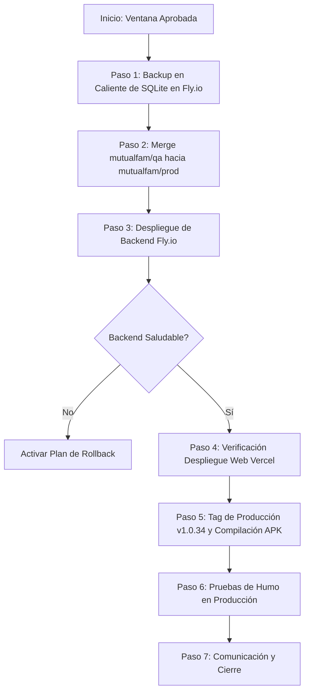

# Plan de Control de Cambios: Pase a Producción (v1.0.34)

> **Documento:** Plan de Gestión y Control de Cambios (RFC)  
> **Fecha de Elaboración:** 31 de Octubre de 2026  
> **Versión Origen (Producción Actual):** `v1.0.25`  
> **Versión Destino (Candidata a Release):** `v1.0.34` (`commit f14cf267`)  
> **Entornos Involucrados:** `mutualfam-qa` ➔ `mutualfam-prod`  
> **Estado:** 🟡 Pendiente de Aprobación y Ejecución  

---

## 1. Contexto y Justificación del Cambio

Desde el lanzamiento de la versión Beta (`v1.0.25`), la plataforma MutualFam ha estado operando en producción con usuarios reales (núcleo familiar y evaluadores iniciales), procesando solicitudes de préstamos, aportes, registros bancarios y acuerdos mutuos.

Durante este período de funcionamiento activo, se acumularon múltiples mejoras estructurales, optimizaciones y correcciones en la rama `mutualfam/qa` que han sido homologadas y certificadas con el **100% de éxito en 38 pruebas automatizadas E2E**.

Dado que **es el primer pase a producción con la aplicación en caliente y usuarios activos**, se requiere un procedimiento formal, metódico y seguro para garantizar:
1. **Cero pérdida de datos** transaccionales ni de configuración en la base de datos SQLite de producción.
2. **Compatibilidad retroactiva** mientras los usuarios de Android migran a la nueva versión de la APK.
3. **Mínima o nula ventana de indisponibilidad** en el servicio Backend (Fly.io) y Web/PWA (Vercel).
4. **Capacidad de reversión inmediata (Rollback)** ante cualquier contingencia.

---

## 2. Alcance del Release (Diferencial v1.0.25 ➔ v1.0.34)

El pase a producción consolida 9 versiones menores/parches probadas en QA:

| Componente | Mejoras y Cambios Clave Incorporados |
|---|---|
| **Base de Datos & Backend** | • Nueva columna en `loan_requests`: `last_repayment_reminder_date` (con auto-migración segura).<br>• Tarea en segundo plano de recordatorios push automáticos de vencimiento (D-3, D-1, D-0, D+2).<br>• Blindaje estricto de invitaciones únicas de un solo uso (`HTTP 400`).<br>• Límite de miembros por mutual (`15` en producción vs `5` en QA).<br>• Regla 1 de gobernanza: límite de 1 mutual extra por miembro fundador. |
| **Moneda & Finanzas** | • Sistema bimoneda completo (USD y Bs. VES) con tasa dinámica oficial BCV.<br>• Memoria de preferencia de visualización monetaria en cliente.<br>• Homologación de métodos de pago venezolanos (Pago Móvil y Transferencia) en solicitud, aporte y devolución. |
| **Clientes Móviles & Web** | • **Manejo offline robusto:** detección de corte de red, estados vacíos informativos, banners de desconexión y retención de mutual activa en memoria local sin expulsar sesión.<br>• **Experiencia iOS / PWA:** layout nativo con pestañas inferiores, selector de mutual optimizado, y guía de instalación en Safari.<br>• **Descargas Android:** flujo dual simplificado (descarga directa de APK y distribución vía Firebase App Distribution).<br>• **Tematización visual:** paleta azul corporativa distintiva para Producción (evitando confusión con verde esmeralda de QA).<br>• **Reconocimientos Beta:** inclusión de evaluadores familiares (Nora Salazar, Nilso Salazar, Martín Vieira). |

---

## 3. Matriz de Riesgos y Acciones de Mitigación

| # | Riesgo Identificado | Nivel de Impacto | Probabilidad | Estrategia de Mitigación |
|---|---|:---:|:---:|---|
| **R1** | **Inconsistencia o daño en SQLite de Prod (`mutualfam.db`)** | 🔴 Crítico | Baja | • **Backup previo obligatorio:** Descarga física completa del archivo `.db` antes de cualquier despliegue.<br>• La migración de columna se ejecuta con `ALTER TABLE ADD COLUMN` tolerante a fallas (`try/except`). |
| **R2** | **Usuarios con APK v1.0.25 antigua interactuando con nueva API** | 🟠 Alto | Media | • Los endpoints mantienen compatibilidad estricta con los contratos JSON previos.<br>• Campos nuevos (`last_repayment_reminder_date`) son opcionales/invisibles para APKs legacy. |
| **R3** | **Interrupción de transacciones durante reinicio de Fly.io** | 🟡 Medio | Media | • Despliegue en ventana de baja concurrencia (ej. 10:00 PM - 11:30 PM o madrugada).<br>• Fly.io utiliza estrategia de arranque de nueva máquina antes de apagar la anterior si la configuración lo permite. |
| **R4** | **Caché en navegadores o PWA de iOS mostrando versión vieja** | 🟡 Medio | Media | • Configuración de cabeceras en `vercel.json` (`Cache-Control: no-cache, must-revalidate`).<br>• Versión visible en Perfil/Ajustes para verificación por parte del usuario. |
| **R5** | **Falla en compilación de APK en GitHub Actions** | 🟡 Medio | Baja | • Pipeline validado exhaustivamente en QA con tags `v1.0.32-qa` a `v1.0.34-qa`.<br>• Si la APK falla, no afecta al Backend ni a la Web/PWA que ya estarán operativos. |

---

## 4. Criterios de Aceptación (Go / No-Go Decision Gate)

Para dar la orden de inicio (**GO**) del pase a producción, se deben cumplir todas las condiciones:

- [ ] **C1. Pruebas QA Finales:** Usuario y equipo de QA completan y aprueban las pruebas manuales de la versión `v1.0.34-qa`.
- [ ] **C2. Certificación E2E Vigente:** 38 de 38 pruebas automatizadas aprobadas contra el backend cloud.
- [ ] **C3. Backup de Base de Datos Realizado:** Copia descargada localmente y verificada con `PRAGMA integrity_check;`.
- [ ] **C4. Secretos de Producción Verificados:** Existencia y vigencia de `FLY_API_TOKEN_PROD` y credenciales de Firebase en GitHub Actions.
- [ ] **C5. Ventana Horaria Acordada:** Notificación enviada al grupo familiar anticipando la actualización.

> [!CAUTION]
> Si cualquiera de los criterios C1 a C4 no se cumple, el pase se suspende (**NO-GO**) y se reprograma.

---

## 5. Procedimiento de Despliegue Paso a Paso



### Paso 1: Respaldo Preventivo de Base de Datos (Producción)
Antes de tocar cualquier línea de código o rama, se realiza la copia de seguridad de la base de datos de producción desde el volumen persistente de Fly.io:

```bash
# 1. Crear carpeta de respaldo local fechada
mkdir -p ./backups/prod_$(date +%Y%m%d_%H%M%S)

# 2. Conectar por SFTP a Fly.io y descargar la base de datos de producción
fly ssh sftp get /app/data/mutualfam.db ./backups/prod_latest.db -a mutualfam-backend

# 3. Validar integridad de la copia descargada
sqlite3 ./backups/prod_latest.db "PRAGMA integrity_check;"
# Resultado esperado: ok
```

---

### Paso 2: Promoción de Código (Merge de QA a Prod)
Se integra el árbol de cambios limpio y certificado de `mutualfam/qa` a `mutualfam/prod`:

```bash
# 1. Cambiar a la rama de producción
git checkout mutualfam/prod

# 2. Asegurar que está sincronizada con el remoto
git pull origin mutualfam/prod

# 3. Integrar los cambios certificados de QA
git merge mutualfam/qa --no-ff -m "chore(release): promocion de QA v1.0.34 a produccion"

# 4. Enviar a los remotos principales
git push github mutualfam/prod
git push origin mutualfam/prod
```

---

### Paso 3: Despliegue del Backend en Producción (Fly.io)
El push a `mutualfam/prod` disparará automáticamente el workflow `.github/workflows/deploy-backend.yml` configurado con `fly.toml` y la app `mutualfam-backend`.

*Monitoreo del despliegue:*
```bash
# Ver estado de la máquina y logs en vivo
fly logs -a mutualfam-backend
fly status -a mutualfam-backend
```

*Verificación inmediata del Backend:*
```bash
# Verificar endpoint público de configuración y salud
curl -s https://mutualfam-backend.fly.dev/api/v1/config/ | jq .
```
Debe responder con `phase: "Beta"`, `limits.max_members_per_mutual: 15`, y tasa BCV activa.

---

### Paso 4: Verificación de la Web App / PWA (Vercel)
Vercel desplegará automáticamente la rama `mutualfam/prod` en el dominio `https://mutualfam.vercel.app`.

*Verificaciones requeridas:*
1. Abrir `https://mutualfam.vercel.app` en modo incógnito.
2. Comprobar que el tema visual corresponda a Producción (azul) y no a QA (esmeralda).
3. Verificar en `Ajustes / Perfil` que el número de versión indique `1.0.34`.
4. Comprobar que no haya errores de consola en DevTools.

---

### Paso 5: Generación y Publicación de la APK de Producción
Para disparar el workflow de compilación de Android (`build-apk.yml`) en modo **Producción**, se crea y publica el tag sin sufijo `-qa`:

```bash
# 1. Crear tag oficial de producción
git tag -a v1.0.34 -m "Release Produccion v1.0.34: soporte offline, bimoneda, limites y mejoras UI"

# 2. Publicar tag
git push github v1.0.34
git push origin v1.0.34
```

*Acciones automáticas desencadenadas por el tag `v1.0.34`:*
- Configura entorno como `production` (`com.jorgerojasve.mutualfammobile`).
- Apunta a la API `https://mutualfam-backend.fly.dev/api/v1`.
- Compila la APK release y genera el artifact.
- Crea el Release en GitHub (`v1.0.34`) con la APK descargable (`mutualfam-v1.0.34.apk`).
- Distribuye la versión a los evaluadores en **Firebase App Distribution**.

---

## 6. Pruebas de Humo Post-Despliegue (Smoke Testing en Prod)

Ejecutar inmediatamente después de que el backend y web estén en línea:

| # | Prueba de Humo | Método | Criterio de Éxito |
|---|---|---|---|
| **ST-1** | Consulta de salud de API | `GET /config/` | HTTP 200, límites correctos (15 miembros). |
| **ST-2** | Login de usuario existente | Web / PWA | Ingreso sin errores, token JWT renovado. |
| **ST-3** | Integridad de datos previos | Pantalla Inicio | La mutual existente, sus miembros y préstamos históricos se muestran intactos. |
| **ST-4** | Persistencia de método de pago | Perfil / Ajustes | Datos de Pago Móvil y cuentas bancarias previas se cargan correctamente. |
| **ST-5** | Comprobación bimoneda | Solicitud de préstamo | Conmutador USD / Bs. calcula monto según tasa BCV actual. |
| **ST-6** | Descarga de nueva APK | Web landing / Firebase | Enlace directo descarga correctamente el binario v1.0.34. |

---

## 7. Plan de Rollback (Reversión de Emergencia)

Si ocurre una falla crítica no subsanable en los primeros 30 minutos (ej. caída persistente de la API, corrupción de datos, o incompatibilidad fatal):

### Criterios de Disparo de Rollback:
- La base de datos SQLite reporta errores de esquema o bloqueo no recuperable.
- Más del 50% de las pruebas de humo fallan.
- El backend en Fly.io queda en ciclo de reinicio permanente (`crash loop`).

### Procedimiento de Rollback:
1. **Restauración de Base de Datos:**
   ```bash
   fly ssh sftp put ./backups/prod_latest.db /app/data/mutualfam.db -a mutualfam-backend
   ```
2. **Reversión de Imagen / Release en Fly.io:**
   ```bash
   fly releases -a mutualfam-backend
   fly rollback [RELEASE_ANTERIOR] -a mutualfam-backend
   ```
3. **Reversión de Git:**
   ```bash
   git checkout mutualfam/prod
   git revert -m 1 HEAD --no-edit
   git push github mutualfam/prod
   git push origin mutualfam/prod
   ```
4. **Notificación de Contingencia:**
   Informar a los usuarios que se mantiene temporalmente la versión anterior mientras se evalúa el incidente.

---

## 8. Estrategia de Comunicación con Usuarios (Familiares Beta)

Al tratarse de una base de usuarios cercana y activa, la comunicación debe ser clara, amigable y estructurada, destacando el valor de las nuevas funciones:

### 8.1. Mensaje Previo a la Ventana de Mantenimiento (4 a 6 horas antes):
> *"¡Hola a todos! 🌟 Hoy a las [HORA] estaremos realizando una actualización en MutualFam para activar un paquete importante de mejoras solicitadas por todos. La aplicación podría presentar breves intermitencias de unos 15 minutos durante ese horario. Les avisaremos en cuanto esté 100% lista para que puedan disfrutar de la nueva versión."*

### 8.2. Mensaje Posterior de Notificación de Mejoras e Instrucciones:
> *"¡Actualización lista! 🚀 Hemos liberado la versión **v1.0.34** de MutualFam con importantes mejoras que hacen la app mucho más cómoda y segura:*
>
> 🔹 **1. Soporte de red sin conexión:** Si la señal falla o se corta el internet, la aplicación ya no se bloquea ni te expulsa; tus datos, tu perfil y tu mutual activa permanecen visibles en pantalla con un indicador claro de 'Sin conexión'.  
> 🔹 **2. Bimoneda (USD / Bs. VES):** Ahora puedes ver los montos tanto en dólares como en bolívares calculados al instante con la tasa oficial del Banco Central de Venezuela (BCV), con selector interactivo y memoria de tu preferencia.  
> 🔹 **3. Mitigación de invitaciones duplicadas:** Códigos de invitación reforzados de un solo uso para garantizar que cada nuevo integrante ingrese de manera ordenada y segura.  
> 🔹 **4. Límites de miembros:** Control automático de capacidad en cada mutual para asegurar la estabilidad del grupo familiar.  
> 🔹 **5. Recordatorios de devolución:** Alertas amigables y automáticas para estar al tanto de las fechas de vencimiento de préstamos y no olvidar ningún compromiso.  
>
> ---
> **¿Cómo actualizar?**  
> 📲 **Si usas Android (APK):** Ingresa a `https://mutualfam.vercel.app` para descargar la nueva APK directa o haz clic en la notificación de Firebase App Distribution.  
> 🍎 **Si usas iPhone / Web:** Solo abre la app desde la pantalla de inicio y recarga; se actualizará automáticamente a la versión 1.0.34.  
>
> *¡Gracias a Nora, Nilso, Martín, Maira y a toda la familia por su apoyo y por ayudarnos a probar cada detalle! ❤️"*

---

## 9. Registro de Aprobaciones

| Rol | Responsable | Firma / Estado | Fecha |
|---|---|:---:|:---:|
| **Líder de Proyecto / Dev** | Jorge Rojas | Pendiente | -- |
| **Control de Calidad (QA)** | Equipo QA / Certificación | ✔ Aprobado (38/38) | 30/10/2026 |
| **Analista de Calidad (iOS/PWA)** | Martín Vieira | Pendiente | -- |
